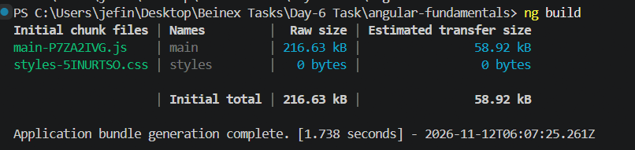
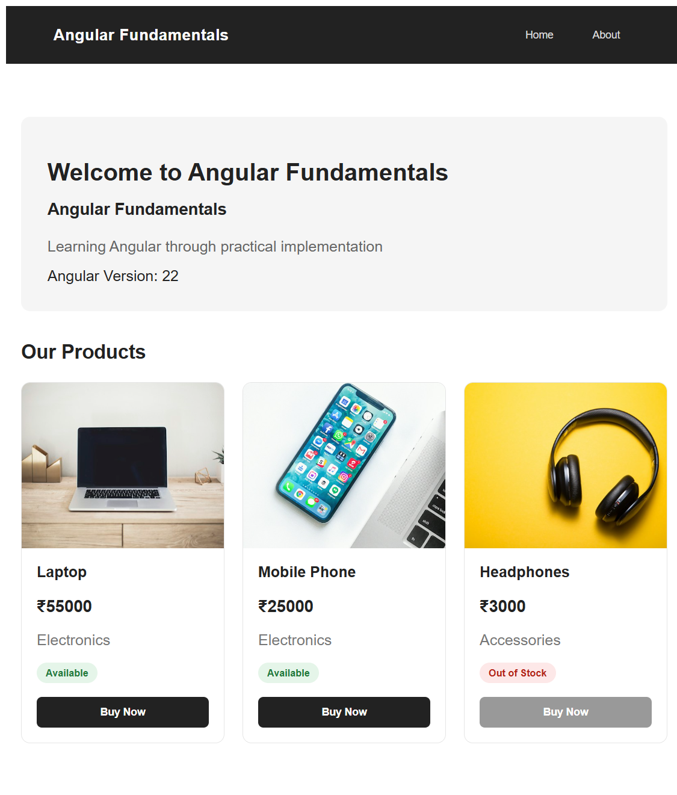
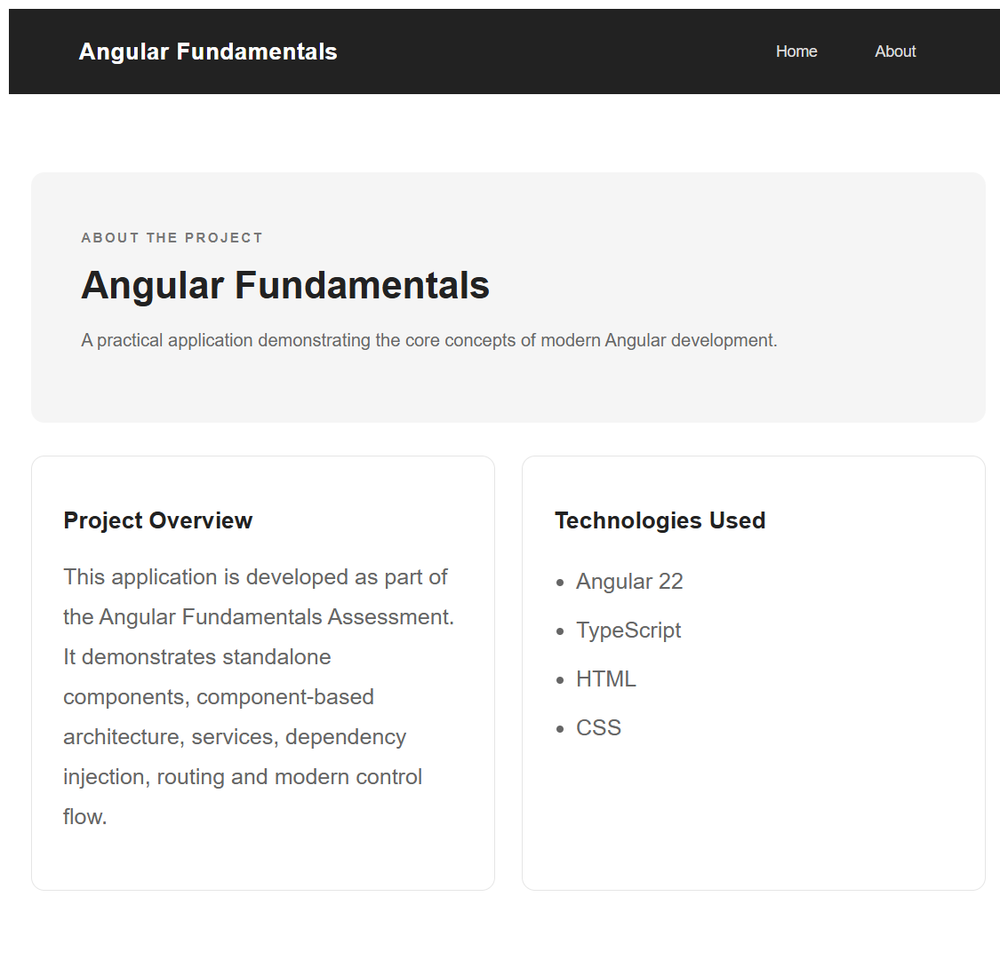

## Project Overview

A simple product catalogue application developed as part of the Angular Fundamentals Assessment using Angular 22, TypeScript, HTML and CSS.
The application consists of two pages:

- **Home:** Displays a product catalogue with product images, names, prices, categories and availability status.
- **About:** Provides an overview of the project and the technologies used.

## Technologies Used

- Angular 22
- TypeScript
- HTML5
- CSS3

## Angular Concepts Implemented

### 1. Standalone Components
Used Angular standalone components to build the application without NgModules.

### 2. Component-Based Architecture
Organized the application into reusable and maintainable components.

### 3. Services and Dependency Injection
Created an injectable `ProductService` to manage product data and used Angular's `inject()` function to access the service from the Home component.

### 4. Routing
Implemented two routes:
- `/` – Home
- `/about` – About

Added navigation links to move between the pages.

### 5. Modern Angular Control Flow
Used Angular's built-in control flow:

- `@for` – To iterate through and display products.
- `@if` and `@else` – To display product availability based on stock status.

## Project Structure


angular-fundamentals/
│
├── src/
│   └── app/
│       ├── components/
│       │   ├── home/
│       │   └── about/
│       │
│       ├── services/
│       │   └── product.ts
│       │
│       ├── models/
│       │   └── product.model.ts
│       │
│       ├── app.config.ts
│       ├── app.routes.ts
│       ├── app.ts
│       └── app.html
│
├── screenshots/
│   ├── 01-successful-build.png
│   ├── 02-control-flow.png
│   └── 03-about-navigation.png
│
├── angular.json
├── package.json
└── README.md


## Installation and Setup


### Run the Application

```bash
ng serve
```

Open your browser and navigate to:

```text
http://localhost:4200
```
### Production Build

To generate an optimized production build, run:

```bash
ng build
```
The generated build files are available inside the `dist/` directory.


## Screenshots

### 1. Successful Angular Build



### 2. Product Catalogue and Angular Control Flow



### 3. About Page and Navigation




## Conclusion

This project demonstrates the fundamental concepts of Angular development through a simple product catalogue application, with a focus on standalone components, services, dependency injection, routing and modern template control flow.


